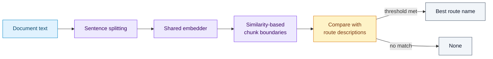
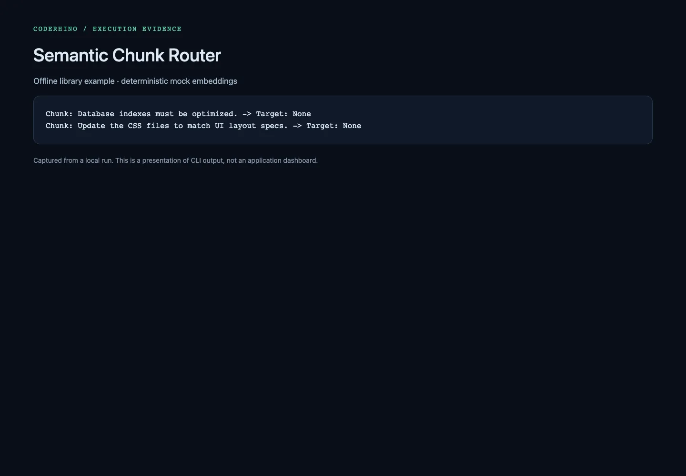

# Semantic Chunk Router

A small Python library for embedding-based sentence chunking and threshold-based routing. Use it to experiment with how document boundaries and route descriptions affect downstream selection.

## How text becomes a route

The chunker groups neighboring sentences using cosine similarity. The router compares each chunk with the configured route descriptions and returns the best route that meets its own threshold, or `None`.



## Install and try it

Requires Python 3.8+ and NumPy; see [pyproject.toml](pyproject.toml).

```bash
python3 -m venv .venv
. .venv/bin/activate
pip install -e .
python examples/basic_routing.py
```

```python
from semantic_chunk_router import Route, SemanticChunker, SemanticRouter

chunker = SemanticChunker(similarity_threshold=0.82)
router = SemanticRouter([
    Route("agents", "Agent orchestration and language models"),
    Route("oncall", "Paging and incident response"),
])

for chunk in chunker.chunk_text("Agent orchestration uses language models. Paging handles incidents."):
    print(chunk["text"], "->", router.route_chunk(chunk["text"]))
```

## Choosing an embedder

The default `MockEmbedder` produces normalized, deterministic vectors from a hash of the **whole input text**. It requires NumPy but no network, model, or API key. It is useful for exercising interfaces and repeatability; its scores do not measure semantic relevance, so unrelated routing or `None` is expected.

For meaningful semantic behavior, pass a real embedding adapter to both constructors using `embedder=...`. The router adapter must expose `embed_text(text)`; the chunker also needs `embed_documents(texts)`. Both return consistent vectors. Use the same model and dimensions for sentences, chunks, and route descriptions; calibrate thresholds on representative labeled examples.

## Development

```bash
pip install pytest
python -m pytest
```

Read [the chunker](src/semantic_chunk_router/chunker.py), [router](src/semantic_chunk_router/router.py), and [offline example](examples/basic_routing.py) for the compact implementation. This library chooses route names; executing tools, invoking LLMs, and writing to vector databases belong to the calling application.

`Route` is exported from the package root and remains available from `semantic_chunk_router.router`. Routing regression tests inject known vectors to check highest-score selection, individual thresholds, ties, and no-match behavior without network calls. Separate tests exercise the offline embedder’s repeatability and exact-text route matching; they do not claim semantic understanding.

## Captures

Offline mock-embedding example. It does not measure semantic quality.



Full capture descriptions and provenance: [captures.json](docs/screenshots/captures.json).
